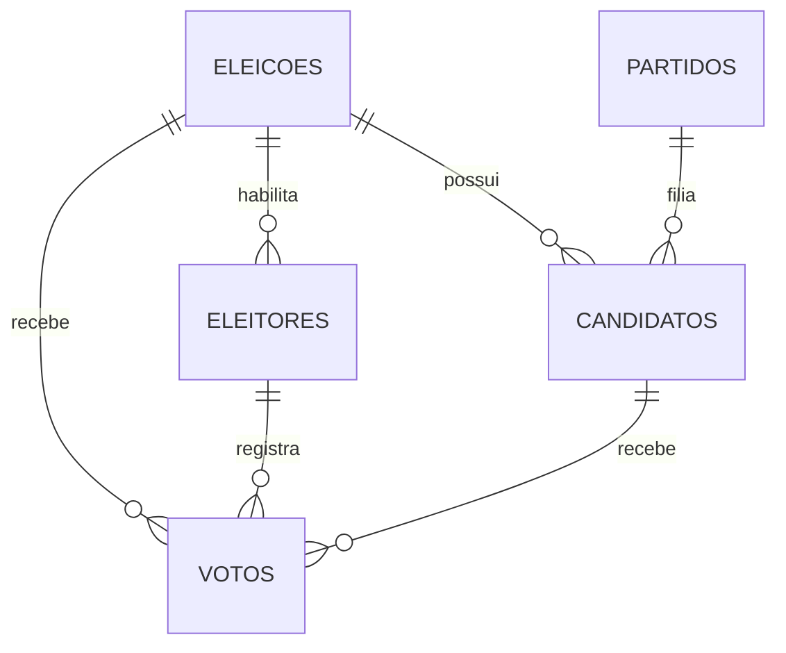

# Modelo conceitual e lógico

## Dicionário resumido
- **usuarios**: contas administrativas/operacionais; senha armazenada em hash.
- **eleicoes**: nome, descrição, status e período da eleição fictícia.
- **eleitores**: identificador fictício, nome, hash da senha, status, indicador `votou` e eleição vinculada.
- **partidos**: nome, sigla e número fictícios; sigla e número únicos.
- **candidatos**: nome, número, cargo, avatar/foto e vínculos com partido e eleição. Número único por eleição.
- **votos**: eleição, eleitor, candidato opcional, tipo (válido/branco/nulo) e data. Restrição única impede mais de um voto por eleitor em cada eleição.
